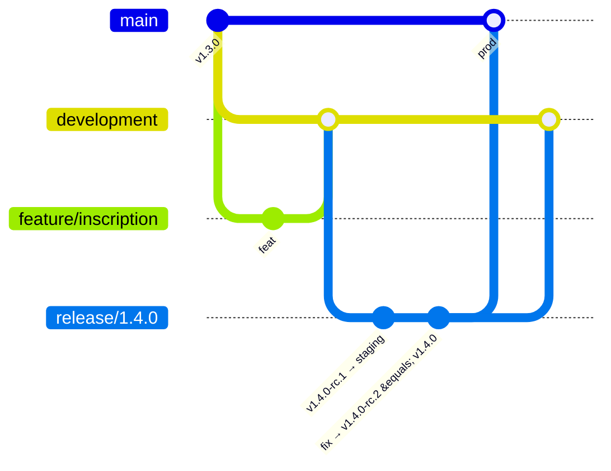

# Contribuer à Steamy

## Workflow Git (gitflow)



| Branche | Rôle | Créée depuis | Fusionnée dans |
| --- | --- | --- | --- |
| `main` | Ce qui est en production | — | — |
| `development` | Intégration de la prochaine version | — | — |
| `feature/<sujet>` | Nouvelle fonctionnalité | `development` | `development` |
| `fix/<sujet>` | Correction de bug pas urgente | `development` | `development` |
| `release/<x.y.z>` | Préparation et recette d'une version | `development` | `main` **et** `development` |
| `hotfix/<x.y.z>` | Correction urgente de la production | `main` | `main` **et** `development` |

**Aucun commit direct sur `main` ni sur `development`** : tout passe par une pull request, et le check
`ci-ok` doit être vert. Ces deux branches sont protégées sur GitHub.

### Nommage

- Branches en minuscules, avec des tirets : `feature/inscription-parent`, `fix/csrf-logout`, `release/1.4.0`.
- Commits sur une ligne, au format [Conventional Commits](https://www.conventionalcommits.org/fr/), en français :
  `feat(web): …`, `fix(api): …`, `docs(infra): …`, `ci: …`, `chore: …`.

### Travailler sur une fonctionnalité

```bash
git switch development && git pull
git switch -c feature/inscription-parent
# … commits …
git push -u origin feature/inscription-parent
```

Puis ouvrir une PR vers **`development`**. Une fois la PR fusionnée, supprimer la branche.

## Publier une version

Les déploiements sont déclenchés par les GitHub Releases (voir [CI/CD](docs/infra/ci-cd.md)).
Règle clé : **la release de prod se tague sur le même commit que la dernière rc validée**, parce que la
production réutilise les images construites pour le staging, sans les reconstruire.

1. **Ouvrir la release**

   ```bash
   git switch development && git pull
   git switch -c release/1.4.0
   git push -u origin release/1.4.0
   ```

2. **Déployer en staging** : GitHub → Releases → *Draft a new release*. Créer le tag `v1.4.0-rc.1`,
   avec pour cible **`release/1.4.0`**, cocher *Set as a pre-release*, puis publier.

3. **Recette en staging.** Pour chaque correction : une PR `fix/…` vers `release/1.4.0`, puis une nouvelle
   pre-release `v1.4.0-rc.2` sur `release/1.4.0`.

4. **Déployer en production** : nouvelle release avec le tag `v1.4.0`, cible **`release/1.4.0`** (le même
   commit que la dernière rc), **sans** cocher pre-release. Une approbation est demandée.

5. **Clôturer** :
   - PR `release/1.4.0` → `main`, puis PR `release/1.4.0` → `development` ;
   - fusionner avec un **merge commit**, pas un squash, pour que le commit tagué fasse partie de l'historique de `main` ;
   - supprimer `release/1.4.0`.

### Correctif urgent en production (hotfix)

Même déroulé, mais à partir de `main` :

```bash
git switch main && git pull
git switch -c hotfix/1.4.1
```

Le correctif passe par une PR vers `hotfix/1.4.1`. Ensuite :
1. pre-release `v1.4.1-rc.1` sur `hotfix/1.4.1` (staging) ;
2. release `v1.4.1` sur le même commit (production) ;
3. PR vers `main` **et** vers `development`.

## Avant d'ouvrir une PR

```bash
make test-api                 # si l'API a changé
make fix-api                  # lint et format de l'API (Ruff), corrections automatiques
make openapi                  # si un serializer ou une vue a changé, puis committer les fichiers générés
make lint-web typecheck-web   # si le front a changé
```

La CI refait ces vérifications ; les lancer localement évite un aller-retour.
