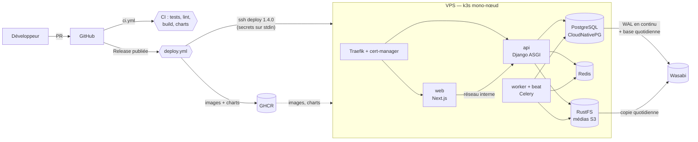

# Infrastructure Steamy

Documentation de référence de l'infrastructure : comment Steamy tourne en local,
comment le code arrive en production, et comment exploiter les serveurs.

| Page | Pour qui, pour quoi |
| --- | --- |
| [Développement local](developpement-local.md) | Lancer la stack, commandes du quotidien, contrat front/API |
| [CI/CD](ci-cd.md) | Vérifications sur les PR, publication d'une version, promotion staging → prod |
| [Mise en place](mise-en-place.md) | Créer un environnement de zéro (VPS, DNS, Wasabi, GitHub) |
| [Serveurs](serveurs.md) | Ce qu'Ansible installe, modèle de sécurité, montées de version |
| [Kubernetes](kubernetes.md) | Les deux charts Helm, les composants, la séquence d'un déploiement |
| [Données et sauvegardes](donnees-et-sauvegardes.md) | PostgreSQL, RustFS, Redis, sauvegardes Wasabi, restauration |
| [Exploitation](exploitation.md) | Procédures : logs, rollback, secrets, incidents |
| [Référence de configuration](reference-configuration.md) | Toutes les variables, secrets et valeurs Helm |

Les fichiers eux-mêmes sont dans [`infra/`](../../infra), [`compose.yml`](../../compose.yml)
et [`.github/workflows/`](../../.github/workflows).

---

## Vue d'ensemble

### Les choix structurants

| Sujet | Choix | Pourquoi |
| --- | --- | --- |
| Dépôt | Monorepo : `apps/web` (Next.js 16), `apps/api` (Django 5.2), `packages/api-client` | Front, API et contrat évoluent dans la même PR |
| Contrat front/API | OpenAPI généré par Django → types TypeScript générés | Une API qui change casse le typecheck du front, pas la prod |
| Authentification | Session Django, cookie HttpOnly sur le domaine parent partagé | Pas de jeton à stocker côté navigateur ; CSRF exigé |
| Hébergement | k3s auto-hébergé, **un VPS par environnement** | Aucune dépendance à un fournisseur cloud ; staging isolé de la prod |
| Base de données | PostgreSQL 17 géré par l'opérateur CloudNativePG | Sauvegardes continues et restauration à un instant précis |
| Fichiers | RustFS (compatible S3) dans le cluster | Remplace MinIO ; même API S3 en local et en prod |
| Sauvegardes | Wasabi, 90 jours | Hors du serveur, S3-compatible, sans frais de sortie |
| Déploiement | Déclenché par les GitHub Releases ; images construites **une seule fois** | La prod reçoit exactement ce qui a été recetté en staging |
| Accès CI → serveur | SSH avec **commande forcée** | La clé de la CI ne peut rien faire d'autre que `deploy <version>` |
| Secrets | GitHub Environments → transmis sur stdin à chaque déploiement | Aucun secret dans le dépôt ni sur le disque de la CI |

### Environnements

| | Local | Staging | Production |
| --- | --- | --- | --- |
| Où | Docker Compose sur le poste | VPS 1 (k3s) | VPS 2 (k3s) |
| Déclencheur | `make up` | **Pre-release** GitHub (`v1.4.0-rc.1`) | **Release** GitHub (`v1.4.0`) + approbation |
| Front | http://localhost:3000 | `https://staging.<domaine>` | `https://<domaine>` |
| API | http://localhost:8000 | `https://api.staging.<domaine>` | `https://api.<domaine>` |
| `DJANGO_ENV` | `dev` | `staging` | `production` |
| `DEBUG` | activé | désactivé | désactivé |
| Répliques api / web | 1 / 1 | 1 / 1 | 2 / 2 |
| E-mails | capturés par Mailpit | SMTP réel (optionnel) | SMTP réel |
| Paiements | — | clés sandbox | clés réelles |

> Les domaines `*.steamy.example` présents dans `infra/helm/steamy/values-*.yaml` sont des
> **valeurs d'exemple à remplacer** (voir [Mise en place](mise-en-place.md)).

---

## État de validation

| Élément | Validé | Comment |
| --- | --- | --- |
| Stack locale | ✅ | Utilisée au quotidien |
| Charts Helm, migrations, rolling update, rollback automatique | ✅ | Test d'intégration dans k3s sous Docker, versions identiques à la prod |
| Archivage WAL, sauvegarde complète, copie des médias | ✅ | Même test, avec un faux Wasabi (RustFS) |
| Workflows, script de déploiement, playbook | ✅ statique | actionlint, shellcheck, ansible-lint (profil production), kubeconform |
| TLS Let's Encrypt | ❌ | Nécessite un vrai domaine |
| Wasabi réel | ❌ | Nécessite le bucket |
| Playbook Ansible sur un vrai VPS | ❌ | Nécessite les serveurs |
| Restauration PostgreSQL (à côté, à un instant précis, reconstruction après perte du serveur) | ✅ | Procédures de la doc déroulées dans le k3s de test, avec un faux Wasabi |
| **Restauration sur le vrai Wasabi** | ❌ | **À répéter en staging avant d'en avoir besoin** |

## Limites connues

- **Upload direct depuis le navigateur** : les URLs pré-signées pointent vers `http://steamy-rustfs:9000`,
  injoignable depuis l'extérieur. Il faut exposer RustFS (sous-domaine `media.` + ingress) avant
  d'utiliser `/api/core/presign/`.
- **WebSockets en local** : `runserver` ne les sert pas (ils fonctionnent en staging/prod via gunicorn + uvicorn).
- **Un seul nœud par environnement** : une panne du VPS interrompt le service jusqu'à son retour
  ou sa reconstruction (Ansible + restauration depuis Wasabi). C'est le compromis assumé du mono-nœud.
