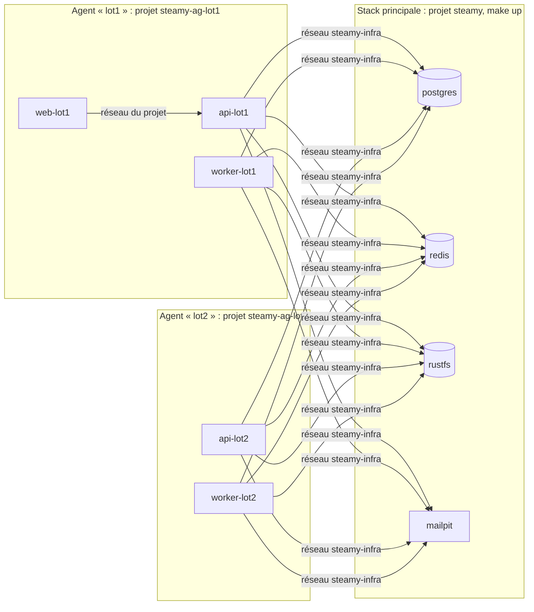

# Environnements d'agent

Pour exécuter des plans en parallèle (méthode des chantiers, [ADR 0007](../adr/0007-methode-chantiers-paralleles.md)),
chaque agent travaille dans son **propre environnement Docker**, peu coûteux : un worktree Git et des conteneurs
applicatifs à lui, mais **aucun service d'infrastructure dupliqué**. Tout passe par `docker`, `make`, `git` et `gh` :
jamais `pnpm`, `node`, `python`, `pytest` ni `playwright` sur l'hôte.

---

## Principe



- La stack principale (`make up`) doit tourner : c'est elle qui porte PostgreSQL, Redis, RustFS et Mailpit, rattachés
  au réseau Docker `steamy-infra` (variable `INFRA_NETWORK`, alias `postgres`, `redis`, `rustfs`, `mailpit`).
- Un agent n'a que ses conteneurs applicatifs (`api-migrate`, `api`, `worker`, `web`), décrits par la surcouche
  [`compose.agent.yml`](../../compose.agent.yml), dans un projet Compose `steamy-ag-<lot>`. Il réutilise l'image
  `steamy-api` déjà construite.
- **Aucun port n'est publié** : tout se joue dans les réseaux Docker (Playwright tourne lui aussi en conteneur).
- **Convention de nommage** : dans un environnement d'agent, un service applicatif s'adresse par `<service>-<lot>`
  (`api-lot1`), jamais par son nom nu (`api`) : plusieurs agents portent le même alias `api` sur `steamy-infra`.

## Isolation des données

| Ressource | Valeur pour le lot `<lot>` |
| --- | --- |
| Base de dev | `steamy_<lot>` |
| Base de tests | `test_steamy_<lot>` (Django préfixe `test_`) ; avec pytest-xdist : `test_steamy_<lot>_gwN` |
| Stockage S3 | buckets `steamy-<lot>` et `steamy-<lot>-test` |
| Redis | deux numéros de base dédiés (cache et broker Celery), attribués dans `2..15` sous verrou |
| E-mails | Mailpit partagé ; les tests pytest utilisent la boîte mémoire de Django ; les e2e de la vraie stack ont **leur propre** Mailpit |
| Variable | `AGENT_LOT=<lot>` dans tous les conteneurs de l'agent |

Sans lot (stack principale), la base de tests est `test_steamy[_gwN]` : c'est ce que vérifie le garde-fou du plan 2.

## Profils

| Profil | Conteneurs | Sert à | Cibles autorisées |
| --- | --- | --- | --- |
| `web` | `web` | Vitest, typecheck, build, e2e sur fixtures | front seulement |
| `api` | `api-migrate`, `api`, `worker` | pytest, migrations, contrat OpenAPI | API + `generate` / `check-generated` |
| `complet` | les quatre | tout, dont l'e2e sur la vraie stack | toutes |

Sans `.agent.env` (stack principale), toutes les cibles sont permises. Une cible interdite par le profil est
refusée **avant** de démarrer le moindre conteneur.

## Budget machine et jeton e2e

Machine cible : Mac 10 cœurs, 24 Go, 14,6 Go alloués à Docker.

```
budget agents = mémoire Docker − MAIN_STACK_MO − 2048 Mo (marge)
```

`scripts/agent-env.sh up` refuse de démarrer un lot si la somme des coûts des profils déjà réservés plus celui du
profil demandé dépasse le budget (message chiffré, aucune option pour contourner). `scripts/agent-env.sh budget`
imprime `budget_mo=<n> utilise_mo=<n> libre_mo=<n>`.

**Jeton e2e** : au plus **1** e2e sur la vraie stack à la fois (`make e2e`). Le jeton est un verrou dans le dépôt Git
commun (`e2e.lock`), pris avant la construction de l'image et rendu en fin de `make e2e` ou par `make e2e-down` ; un
second `make e2e` est refusé en nommant le projet occupant. Un verrou orphelin de plus de 30 minutes dont les conteneurs
ont disparu est repris.

## Cibles `make`

Toutes se lancent **depuis le worktree** de l'agent (le fichier `.agent.env`, gitignoré, y route les commandes vers
ses conteneurs).

| Cible | Rôle | Profils |
| --- | --- | --- |
| `make agent-up LOT=<lot> PROFIL=<web\|api\|complet> BASE=<branche>` | Crée le worktree `../steamy-wt-<lot>` sur `<BASE>-<lot>`, les bases, les buckets, `.agent.env`, démarre les conteneurs | — (depuis le dépôt principal) |
| `make agent-down LOT=<lot>` | Arrête les conteneurs et volumes **de l'agent** | — |
| `make agent-status` | Environnements, mémoire courante, budget | — |
| `make test-cible T="<chemins>"` | Tests ciblés : `apps/api/…` (pytest), `apps/web/…` ou `packages/…` (Vitest) | selon les chemins |
| `make coverage-diff BASE=<branche>` | Rejoue avec couverture les tests des apps Django et fichiers front touchés, puis diff-cover à 100 % contre la base | l'autre moitié du diff est ignorée avec un avertissement |
| `make lint` | ruff (API) et eslint (front) | api : ruff ; web : eslint |
| `make typecheck` | TypeScript (web + api-client) | web, complet |
| `make generate` | Régénère `openapi.yaml` et `schema.d.ts` | api, complet |
| `make check-generated` | Vérifie que ces fichiers sont à jour, sans `git` | api, complet |
| `make migrations-check` | `makemigrations --check --dry-run` | api, complet |
| `make e2e-fixtures` | Parcours Playwright sur fixtures (front de production + fausse API), en conteneur ; `PW_ARGS=…` pour filtrer | web, complet |
| `make e2e` | Parcours Playwright sur la vraie stack, projet `steamy-e2e-<lot>` avec sa base et son Mailpit jetables | complet |

Les cibles historiques (`up`, `down`, `test-api`, `coverage-api`, `lint-api`, `openapi`, `e2e-down`, …) restent
disponibles. `coverage-api` et `coverage-web` acceptent `BASE=` (défaut `origin/development`).

### Détails utiles

- **Tests API** : lancés avec `DJANGO_ENV=test`, comme la CI (le `dev` de `infra/dev/api.env` change des pages testées).
- **Le diff de `coverage-diff` est calculé sur l'hôte**, working tree compris (fichiers neufs inclus) : le `.git` d'un
  worktree pointe vers un chemin de l'hôte, illisible dans un conteneur. Un fichier Python hors d'une app Django
  (`project/`, `libs/`, `conftest.py`) touché déclenche la suite API complète. diff-cover tourne dans l'image
  `python:3.11.13-bookworm` (git requis), avec un cache pip dans le volume `steamy_pip_cache`.
- **Image Playwright** : elle embarque Node 26 **sans corepack** ; pnpm y est installé par npm (version de
  `packageManager`). Ses dépendances vivent dans des volumes dédiés (`pw_*`), séparés de ceux du `web` Alpine.
- **E2E** : la stack e2e d'un lot a son propre réseau (`steamy-e2e-<lot>-infra`) et son image web taguée par lot
  (`steamy-web-e2e-<lot>`) ; elle ne rejoint jamais `steamy-infra`.
- Un lot qui modifie `requirements.txt` ou un Dockerfile doit **reconstruire l'image** (`steamy-api`) : à signaler,
  les environnements d'agent réutilisent l'image de la stack principale.

## Procédure

1. Stack principale démarrée (`make up`).
2. `make agent-up LOT=<lot> PROFIL=<profil> BASE=<branche-du-chantier>` depuis le dépôt principal : le script est
   idempotent (bases et buckets existants réutilisés), refuse un lot actif, un nom invalide (`^[a-z0-9]+$`) ou réservé
   (`test`, `e2e`), une branche ou un worktree déjà présents, et un budget dépassé.
3. Travail dans `../steamy-wt-<lot>` avec les cibles ci-dessus.
4. `make agent-down LOT=<lot>` : conteneurs et volumes de l'agent supprimés, Redis du lot vidé ; **sont conservés** le
   worktree, la branche, les bases `steamy_<lot>` et `test_steamy_<lot>*`, les buckets et `.agent.env` (la reprise
   retrouve les mêmes numéros Redis). Le volume partagé `steamy_pnpm_store` n'est jamais touché.
5. Nettoyage final, à la main, une fois le lot fusionné : `git worktree remove --force ../steamy-wt-<lot>`,
   `git branch -d <branche>`, `DROP DATABASE` des bases du lot, suppression des buckets (la commande exacte est
   affichée par `agent-down`).

## Dépannage

| Symptôme | Que faire |
| --- | --- |
| « la stack principale ne tourne pas » | `make up` dans le dépôt principal |
| Lot bloqué ou conteneurs figés | `docker compose -p steamy-ag-<lot> ps` puis `logs` ; `make agent-down LOT=<lot>` puis `agent-up` (reprise idempotente) |
| Échec de `agent-up` à mi-chemin | Rejouer la même commande ; le message d'échec rappelle la reprise et le nettoyage (rien n'est supprimé automatiquement) |
| Budget dépassé | `make agent-status`, attendre la fin d'un lot |
| Jeton e2e occupé | Attendre, ou `make e2e-down` depuis le worktree du titulaire |
| Base d'un lot à supprimer | Voir le nettoyage final affiché par `agent-down` |
| Redis à purger | `agent-down` vide les deux numéros du lot ; à la main : `redis-cli -n <n> FLUSHDB` dans le conteneur `redis` |
| OOM, timeouts | Machine chargée (`uptime`) : rejouer le fichier seul avant de conclure à un bug |
| 404 HTML sur une route existante du `web` | Redémarrer le conteneur web de l'agent |

---

## Valeurs déclarées

Source des valeurs de `.claude/chantier.projet.md` (plan 3). Mesurées le 5 novembre 2026 sur le Mac de développement
(10 cœurs, 24 Go, Docker 14,6 Go, `MemTotal` Docker = 13 958 Mo).

| Valeur | Mesure |
| --- | --- |
| Mémoire Docker | 13 958 Mo (`MemTotal`) |
| `MAIN_STACK_MO` (stack principale, régime établi) | 2 000 Mo (1 955 Mo mesurés : web 460, worker 847, rustfs 238, api 165, postgres 112, beat 101, redis 20, mailpit 12) |
| Marge | 2 048 Mo |
| **Budget agents** | **9 910 Mo** |
| Coût du profil `web` | 3 400 Mo (repos 411 Mo ; pics : Vitest sur `apps/web/src` 2 750, typecheck 563, `e2e-fixtures` 3 328) |
| Coût du profil `api` | 1 200 Mo (repos 824 Mo ; pics : pytest `apps/core` 992, `coverage-diff` 1 040, `generate` 1 177) |
| Coût du profil `complet` | 6 500 Mo (repos 1 234 Mo ; pic : suite `make e2e` complète 6 469 Mo, 8 min 30 ; `e2e/parcours` seul 5 541) |
| E2E sur la vraie stack simultanés (N) | 1 |
| Temps de `agent-up` (images en cache, volumes pnpm tièdes) | 14 à 16 s ; le premier démarrage d'un lot installe les dépendances pnpm dans ses volumes |
| Temps de `coverage-diff` | API (app `core`, 319 tests) : 48 s ; front (un fichier) : 10 s ; suite complète en CI : plusieurs minutes |

Le coût d'un profil est le **pic total** du lot (conteneurs permanents + conteneurs transitoires de sa cible la plus
lourde), arrondi aux 100 Mo supérieurs. Le budget est une garantie de non-saturation, pas une prédiction : plusieurs
lots simultanés ne culminent pas en même temps.
