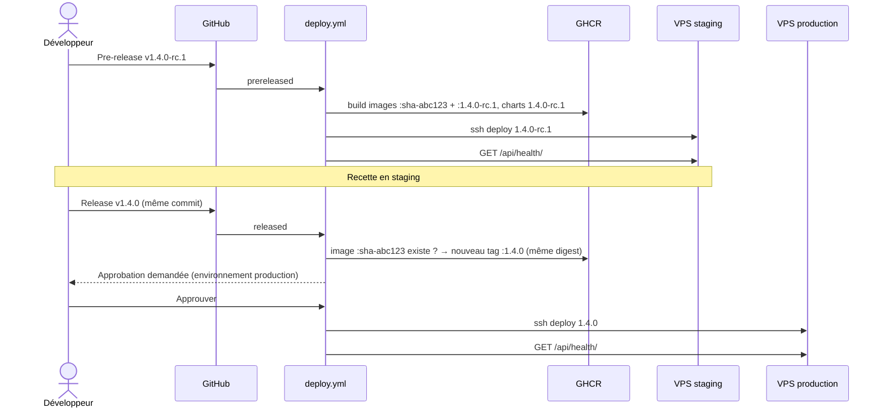

# CI/CD

Deux workflows GitHub Actions :

| Workflow | Déclencheur | Rôle |
| --- | --- | --- |
| [`ci.yml`](../../.github/workflows/ci.yml) | Chaque PR, chaque push sur `main` | Vérifier que rien n'est cassé |
| [`deploy.yml`](../../.github/workflows/deploy.yml) | Publication d'une **GitHub Release** | Construire, publier et déployer |

---

## Intégration continue (`ci.yml`)

Le job `changes` détecte les parties modifiées, et seuls les jobs concernés tournent :

| Job | Lancé si modification de | Vérifie |
| --- | --- | --- |
| `api` | `apps/api/**` | Tests (pytest, avec PostgreSQL et Redis), migrations manquantes, contrat OpenAPI à jour et sans avertissement, lint (**non bloquant** pour l'instant) |
| `web` | `apps/web/**`, `packages/**`, `openapi.yaml`, fichiers pnpm | Types du client à jour, lint, typecheck, build |
| `images` | API ou front | Les images de production se construisent (sans push) |
| `helm` | `infra/**`, workflows | `helm lint` et rendu des deux charts pour staging et prod, validation des manifestes (kubeconform), shellcheck du script de déploiement |
| **`ci-ok`** | toujours | Agrège les résultats : succès si chaque job a réussi ou a été sauté |

**Protection de `main`** : rendre obligatoire le seul check `ci-ok`. Comme les jobs sont conditionnels,
exiger chacun d'eux bloquerait les PR où ils ne tournent pas.

Une nouvelle poussée sur la même branche annule l'exécution en cours (`concurrency`).

---

## Publier une version

### Étapes

1. **GitHub → Releases → Draft a new release.**
   - Tag `v1.4.0-rc.1`, cible `main` (ou le commit voulu).
   - Cocher **Set as a pre-release**, puis publier.
   - Déploiement automatique en **staging**.
2. **Recette en staging.** Si une correction est nécessaire, faire un nouveau commit puis une nouvelle pre-release `v1.4.0-rc.2`.
3. **Release finale.**
   - Nouvelle release `v1.4.0` créée **sur le même commit** que la rc validée, **sans** cocher pre-release.
   - GitHub demande une approbation.
   - Une fois approuvée, la version est déployée en **production**.

### Règles appliquées automatiquement

| Règle | Où |
| --- | --- |
| Tag au format `vX.Y.Z` ou `vX.Y.Z-suffixe`, sinon échec | job `meta` |
| Une release (non pre-release) ne peut pas porter de suffixe `-rc…` | job `meta` |
| La prod ne reconstruit **jamais** d'image : elle réutilise celle de la pre-release du même commit, avec le même digest. Si aucune pre-release n'a construit ce commit, le déploiement échoue | job `images` |
| Une pre-release ne peut pas être déployée en prod, même par erreur | `steamy-deploy` sur le serveur |
| Un seul déploiement à la fois par environnement | `concurrency` (CI) + `flock` (serveur) |
| Approbation humaine avant la prod | réglage de l'environnement GitHub `production` |

### Ce qui est publié sur GHCR

| Artefact | Tags |
| --- | --- |
| `ghcr.io/<owner>/steamy-api` | `sha-<12 caractères>`, `<version>` |
| `ghcr.io/<owner>/steamy-web` | `sha-<12 caractères>`, `<version>` |
| `oci://ghcr.io/<owner>/charts/steamy` | `<version>` |
| `oci://ghcr.io/<owner>/charts/steamy-platform` | `<version>` |

Les charts sont publiés à chaque version, donc une modification d'infra suit exactement le même
cycle pre-release → release que le code.

---

## Le déploiement (job `deploy`)

1. **Clé SSH et empreinte du serveur** : écrites depuis les secrets `DEPLOY_SSH_KEY` et `DEPLOY_KNOWN_HOSTS`.
   Le client SSH refuse tout serveur dont l'empreinte diffère (`StrictHostKeyChecking=yes`).
2. **Secrets** : les secrets de l'environnement GitHub sont écrits au format `KEY=VALUE` dans un fichier temporaire
   (`umask 077`). Une valeur sur plusieurs lignes est refusée.
3. **`ssh deploy@$DEPLOY_HOST "deploy <version>" < secrets.env`** : sur le serveur, la seule commande
   exécutable est [`steamy-deploy`](../../infra/deploy/steamy-deploy.sh). Elle est détaillée dans [Kubernetes](kubernetes.md#séquence-dun-déploiement).
4. **Nettoyage** : la clé et le fichier de secrets sont supprimés, même en cas d'échec.
5. **Contrôle de santé** : `GET $API_URL/api/health/` doit répondre 200 dans les 2 minutes, sinon le job échoue.

### Si un déploiement échoue

| Où ça casse | Conséquence |
| --- | --- |
| Avant le serveur (tag invalide, image absente) | Rien n'est touché |
| Plateforme (base, stockage) | L'application reste sur l'ancienne version. Voir [Exploitation](exploitation.md) |
| Migrations ou démarrage des pods | Helm **revient automatiquement** à la version précédente (`--atomic`) |
| Contrôle de santé | Le job est rouge mais la nouvelle version est en place : investiguer, puis [rollback](exploitation.md#revenir-à-une-version-précédente) si besoin |

**Redéployer** la même version, par exemple après la rotation d'un secret : ouvrir l'exécution du workflow Deploy
de cette version, puis cliquer sur *Re-run all jobs*.
