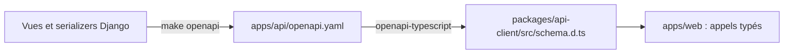

# Développement local

Tout tourne dans Docker : il suffit de Docker Desktop (ou équivalent) et de `make`.
Node et Python n'ont pas besoin d'être installés sur le poste.

```bash
make up        # construit et démarre toute la stack
make help      # liste de toutes les commandes
```

## Services

| Service | Rôle | Accès depuis le poste |
| --- | --- | --- |
| `web` | Front Next.js en mode dev (rechargement à chaud) | http://localhost:3000 |
| `api` | API Django (`runserver`, rechargement à chaud) | http://localhost:8000/api/ — doc : `/api/docs/` — admin : `/admin/` |
| `worker` | Worker Celery (tâches asynchrones) | — |
| `beat` | Planificateur Celery (tâches périodiques) | — |
| `api-migrate` | Applique les migrations au démarrage, puis s'arrête | — |
| `postgres` | PostgreSQL 17 | `localhost:5432` (steamy / steamy) — `make psql` |
| `redis` | Cache, broker Celery, couche Channels | — |
| `rustfs` | Stockage S3 des médias | API `localhost:9000`, console http://localhost:9001 |
| `rustfs-init` | Crée le bucket `steamy-media`, puis s'arrête | — |
| `mailpit` | Capture tous les e-mails envoyés | http://localhost:8025 |
| `flower` | Supervision Celery (à la demande : `make flower`) | http://localhost:5555 |

Ordre de démarrage garanti par `depends_on` : postgres/redis/rustfs → migrations → api, worker, beat → web.

## Configuration

- **API** : [`infra/dev/api.env`](../../infra/dev/api.env). Il est versionné **volontairement** et ne contient que
  des identifiants factices.
- **Front** : variables dans `compose.yml` :
  - `API_URL=http://api:8000` : appels faits par le serveur Next.js, dans le réseau Docker ;
  - `PUBLIC_API_URL=http://localhost:8000` : appels faits par le navigateur.
- **Surcharges personnelles**, comme une clé sandbox KKiaPay ou un SMTP réel : les mettre dans un `compose.override.yml`
  à la racine. Ce fichier est gitignoré et Docker Compose le lit automatiquement :

  ```yaml
  services:
    api:
      environment:
        PAYMENTS_KKIAPAY_SECRET: "…"
  ```

> ⚠️ Ne jamais mettre de vrai secret dans `infra/dev/api.env` ni dans `compose.yml`.

## Commandes du quotidien

| Commande | Effet |
| --- | --- |
| `make up` / `make down` | Démarrer / arrêter (les données sont conservées) |
| `make logs s=api` | Suivre les logs d'un service |
| `make restart` | Redémarrer api, worker, beat et web |
| `make build` | Reconstruire les images (après une modification de `requirements.txt`) |
| `make shell` | Shell dans le conteneur de l'API |
| `make manage c="createsuperuser"` | Commande `manage.py` quelconque |
| `make migrate` / `make makemigrations` | Migrations Django |
| `make seed` | Charge les fixtures (compte admin, gabarits d'e-mails) |
| `make test-api` / `make lint-api` | Tests et lint de l'API |
| `make lint-web` / `make typecheck-web` | Lint et typecheck du front |
| `make openapi` | Régénère le contrat OpenAPI et les types TypeScript |
| `make clean` | ⚠️ Arrête tout **et supprime toutes les données locales** |

Les dépendances Node sont installées dans des volumes Docker, pas dans le dossier du projet. Ainsi,
les binaires natifs macOS et Linux ne se mélangent pas. Après une modification de `package.json`, il suffit
de redémarrer : `docker compose restart web`.

## Le contrat front/API



1. On modifie un serializer ou une vue Django.
2. On lance `make openapi`, qui régénère `openapi.yaml` puis `schema.d.ts`.
3. `make typecheck-web` signale tout ce qui casse côté front.
4. On commite les deux fichiers générés avec la modification.

La CI échoue si ces fichiers ne sont pas à jour, ou si une vue Django est mal décrite dans le schéma
(`--fail-on-warn`). Pour une vue en fonction (`@api_view`), il faut documenter ses entrées et sorties avec
`@extend_schema`.

Côté front, deux clients :

| Contexte | Fonction | Ce qu'elle fait |
| --- | --- | --- |
| Server Component, Server Function | `getServerApi()` | Relaie les cookies `sessionid` et `csrftoken` du visiteur à l'API |
| Composant client | `getBrowserApi()` | Envoie les cookies (`credentials: "include"`) et lit l'URL de l'API sur `/runtime-config` |

Les détails, notamment le flux de connexion par session, sont dans [`packages/api-client/README.md`](../../packages/api-client/README.md).

## Problèmes fréquents

| Symptôme | Cause probable | Solution |
| --- | --- | --- |
| `api` redémarre en boucle | Migration en échec | `make logs s=api-migrate` |
| Le front affiche « Impossible de joindre l'API » | `api` pas encore prête | Attendre, puis `make logs s=api` |
| Erreur 403 CSRF sur un POST depuis le navigateur | En-tête `X-CSRFToken` absent, ou origine non autorisée | Passer par `getBrowserApi()`. Vérifier `WEB_URL` dans `api.env` |
| `localhost:3000` affiche une autre application | Service worker d'un ancien projet dans le navigateur | DevTools → Application → Service Workers → *Unregister* |
| Les uploads n'arrivent pas dans RustFS | Bucket absent | `docker compose up rustfs-init` |
| Modules Node introuvables après un changement de branche | Volumes `node_modules` désynchronisés | `docker compose restart web` (réinstalle) |
