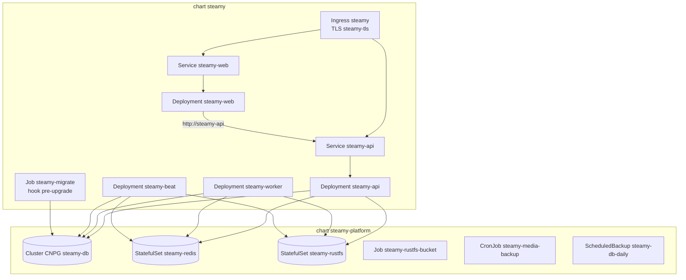
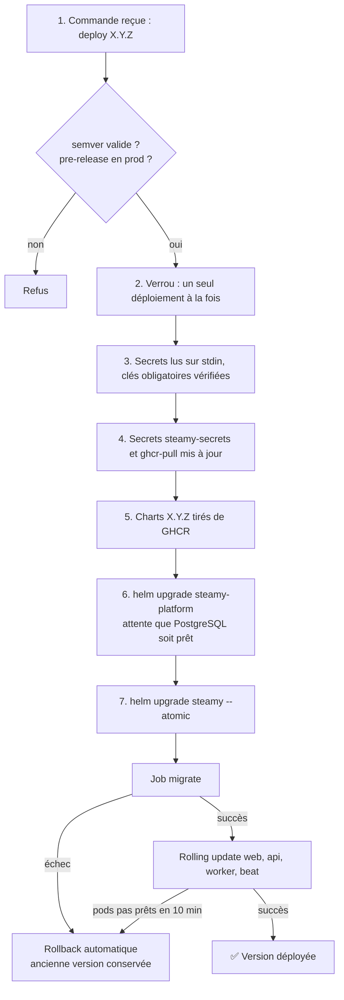

# Kubernetes

Tout Steamy vit dans le namespace **`steamy`** et se décrit en deux charts Helm, installés dans cet ordre :

| Chart | Release Helm | Contenu | Rollback automatique |
| --- | --- | --- | --- |
| [`steamy-platform`](../../infra/helm/steamy-platform) | `steamy-platform` | Services avec état : PostgreSQL, Redis, RustFS, sauvegardes | **Non** : un rollback pourrait supprimer des volumes de données |
| [`steamy`](../../infra/helm/steamy) | `steamy` | Application : web, api, worker, beat, migrations, ingress | **Oui** (`--atomic`) |

Chaque chart a un `values.yaml` commun et un `values-<env>.yaml` par environnement.

## Composants



### Application (`steamy`)

| Composant | Image | Commande | Staging | Production |
| --- | --- | --- | --- | --- |
| `steamy-web` | `steamy-web` | `node apps/web/server.js` (Next.js standalone, port 3000) | 1 réplique | 2 répliques |
| `steamy-api` | `steamy-api` | gunicorn + workers uvicorn (ASGI : HTTP et WebSockets), port 8000 | 1 réplique, 2 workers gunicorn | 2 répliques, 3 workers |
| `steamy-worker` | `steamy-api` | `celery worker` | 1 réplique, concurrence 2 | concurrence 4 |
| `steamy-beat` | `steamy-api` | `celery beat` | 1 réplique, **toujours une seule** (stratégie `Recreate`) | idem |
| `steamy-migrate` | `steamy-api` | `manage.py migrate` | Job avant chaque installation ou mise à jour | idem |

Ressources par défaut (demandes → limite mémoire) :

| Composant | Demandes | Limite mémoire |
| --- | --- | --- |
| api | 100m CPU, 384 Mi | 768 Mi |
| worker | 50m CPU, 256 Mi | 768 Mi |
| beat | 10m CPU, 128 Mi | 256 Mi |
| web | 50m CPU, 192 Mi | 512 Mi |

**Sondes**

| Composant | Prêt (readiness) | Vivant (liveness) |
| --- | --- | --- |
| api | `GET /api/health/` répond 200, donc PostgreSQL et Redis joignables | le port 8000 écoute |
| web | le port 3000 écoute | le port 3000 écoute |

La liveness de l'API ne dépend pas de la base, pour qu'une base qui tousse ne provoque pas de redémarrages en boucle.

**Mises à jour sans coupure** : api et web utilisent `maxUnavailable: 0` et `maxSurge: 1`. Un nouveau pod doit être
prêt avant qu'un ancien ne soit retiré.

**Ingress** : un seul Ingress Traefik route `hosts.web` vers web et `hosts.api` vers api. Le certificat
`steamy-tls` couvre les deux domaines et cert-manager le renouvelle automatiquement.

**Communication front → API** : le serveur Next.js appelle l'API par le réseau interne (`API_URL=http://steamy-api`).
Le navigateur l'appelle par son domaine public (`PUBLIC_API_URL`, servi au client par `/runtime-config`).

### Plateforme (`steamy-platform`)

| Composant | Ressource | Stockage (staging / prod) | Détails |
| --- | --- | --- | --- |
| PostgreSQL 17 | `Cluster` CloudNativePG `steamy-db`, 1 instance | 5 Gi / 20 Gi | Base `app`, propriétaire `app`. Identifiants générés par CNPG dans le Secret `steamy-db-app` (clé `uri`) |
| Redis 7.4 | StatefulSet `steamy-redis` | 1 Gi | Persistance AOF. Bases : `0` broker Celery, `1` cache |
| RustFS 1.0.1 | StatefulSet `steamy-rustfs` | 10 Gi / 50 Gi | API S3 sur le port 9000, console désactivée |
| Création du bucket | Job `steamy-rustfs-bucket` (rclone) | — | Crée `steamy-media` s'il n'existe pas |
| Sauvegardes | voir [Données et sauvegardes](donnees-et-sauvegardes.md) | — | — |

Les volumes utilisent le provisionneur `local-path` de k3s : les données sont **sur le disque du VPS**.
D'où l'importance des sauvegardes hors serveur.

---

## Séquence d'un déploiement

Exécutée sur le serveur par [`steamy-deploy`](../../infra/deploy/steamy-deploy.sh), à l'appel de la CI :



**Secrets et redémarrages** : les pods ne relisent pas un Secret modifié. `steamy-deploy` calcule donc une
empreinte des secrets et la pose en annotation des pods (`steamy.io/secrets-checksum`). Un secret qui change
redémarre ainsi les pods concernés, même si la version déployée est la même. RustFS ne redémarre que si ses
propres identifiants changent.

**Compatibilité des migrations** : pendant le rolling update, l'ancienne et la nouvelle version tournent ensemble
sur la même base. Une migration doit donc rester compatible avec la version N-1. Par exemple, une colonne se
supprime en deux releases : d'abord on arrête de l'utiliser, puis on la supprime.

## Tester les charts localement

```bash
helm lint infra/helm/steamy -f infra/helm/steamy/values-staging.yaml --set image.tag=0.0.0
helm template steamy infra/helm/steamy -f infra/helm/steamy/values-staging.yaml --set image.tag=0.0.0
```

Sans Helm installé :
`docker run --rm -v "$PWD/infra/helm:/c" alpine/helm:3.22.0 template s /c/steamy --set image.tag=0.0.0`.

Pour un test complet, un cluster k3s jetable tourne dans Docker avec
[k3d](https://k3d.io) : `k3d cluster create steamy-test`. Installer alors les prérequis comme le fait
le rôle Ansible `platform`, puis les deux charts.
