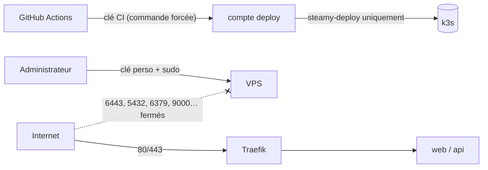

# Serveurs

Chaque environnement tourne sur **un VPS** qui porte un cluster **k3s mono-nœud**.
Le serveur est entièrement préparé par Ansible ([`infra/ansible`](../../infra/ansible)) : aucun réglage
manuel, et le playbook peut être rejoué à volonté (il est idempotent).

```bash
ansible-playbook site.yml --limit staging      # ou --limit production
```

## Ce que fait le playbook

Les rôles s'exécutent dans cet ordre, après une vérification des variables obligatoires.

### `base` : système et sécurité

| Élément | Réglage |
| --- | --- |
| Paquets | `curl`, `ca-certificates`, `ufw`, `fail2ban`, `unattended-upgrades` |
| Mises à jour | Mises à jour de sécurité automatiques (quotidiennes) |
| Administrateurs | Un compte par entrée de `admin_users`, groupe `sudo`, connexion par clé uniquement, sudo sans mot de passe (les comptes n'en ont pas) |
| SSH | Mot de passe désactivé, root interdit, `MaxAuthTries 3`, pas de X11 |
| Pare-feu (ufw) | Entrées autorisées : 22, 80, 443 et les réseaux internes de k3s (`10.42.0.0/16`, `10.43.0.0/16`). Tout le reste refusé, **y compris l'API Kubernetes (6443)** |
| fail2ban | Actif (bannit les IP qui échouent en boucle sur SSH) |

### `k3s` : Kubernetes

- Installe la version épinglée de **k3s**, avec chiffrement des Secrets au repos (`--secrets-encryption`) et un kubeconfig lisible par root seulement.
- Installe **Helm 3**. On reste volontairement en Helm 3, car Helm 4 a renommé l'option `--atomic` utilisée par le déploiement.
- k3s fournit d'office **Traefik** (ingress, ports 80/443), CoreDNS et un provisionneur de volumes locaux (`local-path`, sous `/var/lib/rancher/k3s/storage`).

### `platform` : briques du cluster

Elles sont installées une fois par cluster. Les ressources de Steamy elles-mêmes sont déployées par la CI.

| Brique | Rôle |
| --- | --- |
| **cert-manager** + ClusterIssuer `letsencrypt` | Certificats TLS automatiques, par challenge HTTP via Traefik |
| **Opérateur CloudNativePG** | Gère PostgreSQL : création, sauvegardes, restauration |
| **Plugin Barman Cloud** | Envoie les sauvegardes PostgreSQL vers Wasabi |

### `deploy` : accès de la CI

- Compte `deploy` sans mot de passe, avec un kubeconfig pour piloter le cluster.
- `/usr/local/bin/steamy-deploy` : copie de [`infra/deploy/steamy-deploy.sh`](../../infra/deploy/steamy-deploy.sh).
- `/etc/steamy/deploy.env` : environnement, propriétaire GHCR et namespace (géré par Ansible).
- `authorized_keys` de `deploy` :

  ```
  command="/usr/local/bin/steamy-deploy",restrict ssh-ed25519 AAAA… steamy-ci-staging
  ```

---

## Modèle de sécurité



| Menace | Protection |
| --- | --- |
| Vol de la clé SSH de la CI | Elle ne peut exécuter **que** `steamy-deploy <version>`. Pas de shell, pas de transfert de port, pas d'agent (`restrict`). La version est validée par une regex semver stricte |
| Faux serveur (interception) | La CI vérifie l'empreinte du serveur (`DEPLOY_KNOWN_HOSTS`, `StrictHostKeyChecking=yes`) |
| Secrets exposés | Ils transitent sur stdin, jamais en argument ni sur disque côté CI. Ils sont stockés dans un Secret Kubernetes chiffré au repos. Les identifiants GHCR ne sont pas transmis à l'application |
| Déploiement d'une version non recettée en prod | Refus côté CI (image de pre-release obligatoire) **et** côté serveur (pas de suffixe `-rc` en prod) |
| Accès direct aux services | Pare-feu : seuls 22, 80 et 443 sont ouverts. PostgreSQL, Redis et RustFS ne sont joignables que dans le cluster |
| Brute force SSH | Clés uniquement, root interdit, fail2ban |
| Conteneurs | Utilisateur non-root (UID numérique), privilèges retirés (`drop: ALL`), profil seccomp par défaut |

**Point d'attention** : le compte `deploy` est administrateur du cluster. La protection repose donc sur la
commande forcée. Ne jamais ajouter d'autre clé dans `/home/deploy/.ssh/authorized_keys` à la main
(Ansible écrase ce fichier de toute façon).

---

## Versions épinglées

Toutes dans [`infra/ansible/group_vars/all.yml`](../../infra/ansible/group_vars/all.yml) :

| Composant | Version |
| --- | --- |
| k3s | `v1.36.5+k3s1` |
| Helm | `v3.22.0` |
| cert-manager | `v1.21.2` |
| CloudNativePG | `1.30.1` |
| Plugin Barman Cloud | `v0.15.1` |

### Monter une version

1. Lire les notes de version (ruptures de compatibilité, montées intermédiaires obligatoires).
2. Modifier la version dans `group_vars/all.yml` et ouvrir une PR.
3. Rejouer le playbook **en staging** : `ansible-playbook site.yml --limit staging`.
4. Vérifier : `sudo k3s kubectl get nodes,pods -A`. Publier une pre-release pour valider l'application.
5. Rejouer en production.

> k3s ne doit pas sauter de version mineure (1.36 → 1.37 → 1.38, pas 1.36 → 1.38).
> Une montée de k3s redémarre les pods : prévoir une courte interruption en prod.

Les versions des images de l'application (PostgreSQL, Redis, RustFS, rclone) sont dans les charts Helm
et suivent le cycle normal des releases (voir [Kubernetes](kubernetes.md)).

## Ajouter ou retirer un administrateur

Modifier `admin_users` dans `group_vars/all.yml`, puis rejouer le playbook.
Le retrait d'une entrée **ne supprime pas** le compte existant : le désactiver à la main
(`sudo usermod --expiredate 1 <nom>`) ou retirer sa clé de `~<nom>/.ssh/authorized_keys`.
