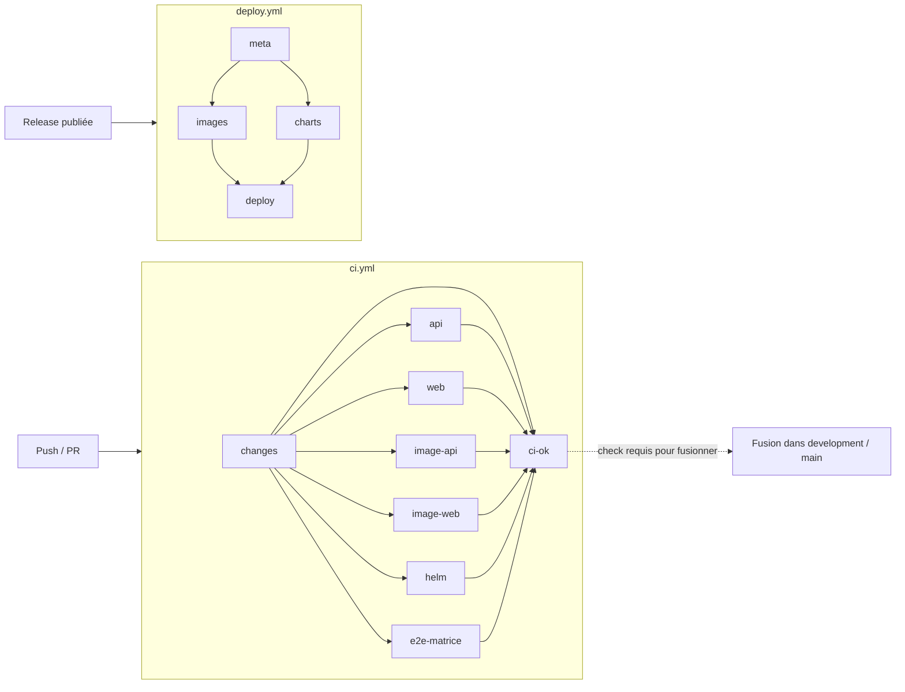
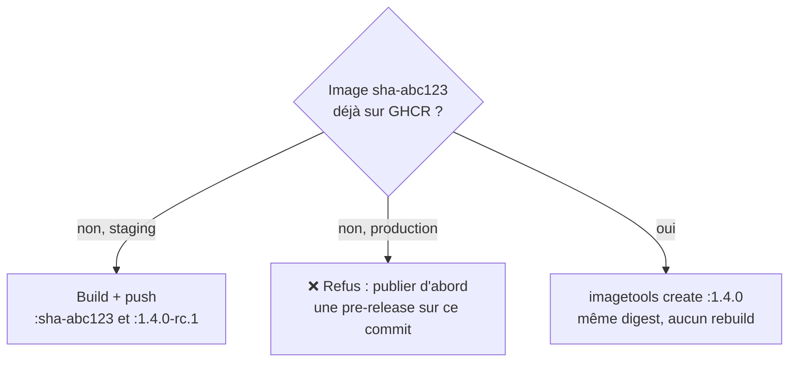

# Workflows GitHub Actions

Référence technique des deux workflows du dépôt : ce que fait chaque job, étape par étape, ce qu'il lit et
ce qu'il faut faire quand il échoue. Pour le **processus** (publier une version, gitflow), voir
[CI/CD](ci-cd.md) et [`CONTRIBUTING.md`](../../CONTRIBUTING.md).

| Fichier | Nom affiché | Déclencheurs | Rôle |
| --- | --- | --- | --- |
| [`.github/workflows/ci.yml`](../../.github/workflows/ci.yml) | **CI** | Push sur toute branche, toute PR | Vérifier que rien n'est cassé |
| [`.github/workflows/deploy.yml`](../../.github/workflows/deploy.yml) | **Deploy** | Publication d'une GitHub Release | Construire, publier, déployer en staging ou en prod |



---

## CI (`ci.yml`)

### Déclencheurs et règles générales

| Réglage | Valeur | Effet |
| --- | --- | --- |
| `on.push.branches` | `"**"` | Chaque push sur n'importe quelle branche (pas les tags) |
| `on.pull_request` | toutes | Chaque PR, quelle que soit la branche cible, sur le **résultat de la fusion** avec la cible |
| `concurrency` | `ci-<ref>`, `cancel-in-progress: true` | Un nouveau push sur une branche annule l'exécution en cours de cette branche |
| `permissions` | `contents: read` | Lecture seule. Le workflow ne peut rien modifier dans le dépôt |
| Runner | `ubuntu-latest` | Voir [Points d'attention](#points-dattention) |

Tant qu'une PR est ouverte, chaque push déclenche **deux** exécutions : `push` (la branche seule) et
`pull_request` (la branche fusionnée avec sa cible). Les deux doivent passer. La protection de branche
regarde le check `ci-ok` du commit de tête.

### Job `changes` : quelles parties ont changé ?

Il utilise [`dorny/paths-filter`](https://github.com/dorny/paths-filter) et produit trois sorties, `api`, `web` et
`infra`, valant `'true'` ou `'false'`. Elles conditionnent tous les autres jobs.

**Les filtres :**

| Sortie | Chemins surveillés |
| --- | --- |
| `api` | `apps/api/**` |
| `web` | `apps/web/**`, `packages/**`, `apps/api/openapi.yaml`, `package.json`, `pnpm-lock.yaml`, `pnpm-workspace.yaml`, `.nvmrc`, `.dockerignore` |
| `infra` | `infra/**`, `.github/workflows/deploy.yml` |
| *(toutes)* | `.github/workflows/ci.yml` : modifier la CI relance tout, pour vérifier la CI elle-même |

`apps/api/openapi.yaml` déclenche `web` : un changement du contrat doit être revérifié côté types TypeScript.
`.dockerignore` (à la racine) déclenche `web`, parce qu'il définit le contexte de build de l'image web.

**Par rapport à quoi on compare** (option `base`) :

| Événement | Comparaison |
| --- | --- |
| `pull_request` | Diff de la PR (la branche par rapport à sa cible). L'option `base` est ignorée |
| Push sur `feature/…`, `fix/…`, `release/…` (et toute autre branche) | Toute la branche par rapport à **`development`** |
| Push sur `hotfix/…` | Toute la branche par rapport à **`main`** |
| Push sur `development` ou `main` | Depuis le push précédent sur cette branche |

Comparer toute la branche, et pas seulement le dernier push, évite un faux vert. Sans ça, un dernier push
qui ne touche que la doc ne relancerait pas les tests de l'API cassée par un push précédent.
`fetch-depth: 0` récupère l'historique nécessaire à cette comparaison.

**Résultat** (vérifié en simulant les filtres) :

| Modification | Jobs lancés |
| --- | --- |
| Front seul | `web`, `image-web` |
| Client d'API (`packages/`) | `web`, `image-web` |
| API sans changement du contrat | `api`, `image-api` |
| API qui change le contrat OpenAPI | `api`, `image-api`, `web`, `image-web` |
| Chart Helm, script de déploiement, `deploy.yml` | `helm` |
| Documentation, design… | aucun (seulement `changes` et `ci-ok`) |
| `ci.yml` | tous |

### Job `api` : l'API Django

Conditions : `changes.api == 'true'`. Répertoire de travail : `apps/api`.

**Services** (conteneurs démarrés à côté du job) : `postgres:17.2` (base `steamy`, avec sonde `pg_isready`) et
`redis:7.4`. Les mêmes versions qu'en local.

**Variables** : `DJANGO_ENV=test`, connexions vers ces services, et
`DEFAULT_FILE_STORAGE=FileSystemStorage` (pas de stockage S3 en CI).

| Étape | Commande | Si elle échoue |
| --- | --- | --- |
| Python 3.11 + cache pip | `actions/setup-python` (cache indexé sur `requirements.txt`) | — |
| Dépendances système | `apt-get install` libpq, pango, harfbuzz (WeasyPrint) | Relancer (miroir apt indisponible) |
| Dépendances Python | `pip install -r requirements.txt` | Version introuvable ou conflit dans `requirements.txt` |
| Lint | `ruff check --output-format=github .` | Erreurs annotées dans le diff de la PR. Corriger avec `make fix-api` |
| Format | `ruff format --check --diff .` | `make fix-api`, puis committer |
| Migrations manquantes | `manage.py makemigrations --check --dry-run` | Un modèle a changé sans migration : `make makemigrations`, puis committer |
| Tests | `pytest --cov` (lignes et branches, rapport `coverage.xml`) | Voir le test en échec (`--maxfail=1` : arrêt au premier) |
| Couverture du code modifié | `diff-cover coverage.xml --compare-branch=<base> --fail-under=100` ; base = cible de la PR, sinon `development` (`main` pour un `hotfix/…`), sinon le push précédent sur `development`/`main` | Ajouter les tests manquants ; le rapport liste les lignes non couvertes. En local : `make coverage-api` |
| Contrat OpenAPI | `spectacular --validate --fail-on-warn`, puis comparaison avec `openapi.yaml` | Vue mal décrite, ou contrat pas régénéré : `make openapi`, puis committer |

Durée habituelle : **≈ 1 min 30**.

### Job `web` : le front Next.js

Conditions : `changes.web == 'true'`.

| Étape | Commande | Si elle échoue |
| --- | --- | --- |
| pnpm + Node | `pnpm/action-setup` (version de `packageManager` dans `package.json`), `setup-node` (version de `.nvmrc`), cache pnpm | — |
| Installation | `pnpm install --frozen-lockfile` | `pnpm-lock.yaml` pas à jour : `pnpm install`, puis committer le lockfile |
| Types du client d'API | `pnpm api-client:generate`, puis `git diff --exit-code schema.d.ts` | `make openapi`, puis committer `schema.d.ts` |
| Lint | `pnpm lint` (ESLint) | `make lint-web` en local |
| Typecheck | `pnpm typecheck` (`next typegen` + `tsc`) | `make typecheck-web` en local |
| Build | `pnpm build` | Reproduire avec `pnpm --filter @steamy/web build` |

Durée habituelle : **≈ 30 s**.

### Jobs `image-api` et `image-web` : les images de production

Conditions : `changes.api` pour `image-api`, `changes.web` pour `image-web`. Ils vérifient que les
Dockerfiles construisent l'image de production (`target: prod`). **Rien n'est poussé.**

| | `image-api` | `image-web` |
| --- | --- | --- |
| Contexte | `apps/api` | racine du dépôt |
| Dockerfile | `apps/api/Dockerfile` | `apps/web/Dockerfile` |
| Cache | `type=gha, scope=api` | `type=gha, scope=web` |
| Durée habituelle | ≈ 30 s avec cache, ≈ 2 min sans | ≈ 25 s |

Le cache de couches Docker est **partagé avec `deploy.yml`** (mêmes `scope`). Un build validé en CI accélère
donc celui de la release.

### Job `helm` : charts et script de déploiement

Conditions : `changes.infra == 'true'`.

| Étape | Détail | Si elle échoue |
| --- | --- | --- |
| Helm `v3.22.0` | Même version que sur les serveurs | — |
| Lint et rendu | `helm lint`, puis `helm template` des 2 charts × 2 environnements (`values-staging`, `values-production`) | Erreur de template ou valeur obligatoire manquante |
| Validation Kubernetes | `kubeconform -strict` sur les 4 rendus. Schémas Kubernetes officiels + [catalogue de CRD](https://github.com/datreeio/CRDs-catalog) (CloudNativePG, Barman, cert-manager) | Champ inconnu ou mal typé dans un manifeste |
| Shellcheck | `shellcheck infra/deploy/steamy-deploy.sh` | Problème de script bash |

Durée habituelle : **≈ 15 s**.

Pour vérifier en local, voir les commandes Docker dans [Kubernetes](kubernetes.md#tester-les-charts-localement).

### Job `e2e-matrice` : 100 % des écrans livrés testés

Toujours lancé (quelques secondes). Exécute `python3 scripts/e2e_matrix.py --check`, qui échoue si :
- un écran à implémenter de l'inventaire n'a pas de ligne dans `docs/tests/MATRICE-E2E.md` ;
- un écran **livré** (case cochée dans la section Avancement de son plan) ne cite aucun test e2e ;
- un test cité n'existe pas.

Après une mise à jour de l'inventaire : `python3 scripts/e2e_matrix.py --generate`.

### Job `ci-ok` : le verdict

Il tourne **toujours** (`if: always()`), après tous les autres. Il réussit si chaque job dont il dépend vaut
`success` ou `skipped`. C'est **le seul check à rendre obligatoire** dans la protection de branche : les autres jobs
étant conditionnels, en exiger un bloquerait les PR où il ne tourne pas.

| Situation | `ci-ok` |
| --- | --- |
| Tous les jobs lancés réussissent, les autres sont sautés | ✅ |
| Un job lancé échoue | ❌ |
| Un job est annulé (nouveau push) | ❌ (l'exécution suivante tranchera) |
| Le job `changes` échoue, ce qui saute tous les autres | ❌ : `changes` est surveillé lui aussi |

---

## Deploy (`deploy.yml`)

### Déclencheurs

```yaml
on:
  release:
    types: [prereleased, released]
```

| Événement GitHub | Quand | Environnement |
| --- | --- | --- |
| `prereleased` | Publication d'une release avec *Set as a pre-release* coché | `staging` |
| `released` | Publication d'une release normale, **ou** transformation d'une pre-release en release | `production` |

Transformer une pre-release `v1.4.0-rc.1` en release déclenche `released`. Le job `meta` le refuse alors,
car une version de prod ne peut pas porter de suffixe. Il faut créer une **nouvelle** release `v1.4.0`.

Les brouillons (*Save draft*) ne déclenchent rien.

`permissions` : `contents: read` au niveau du workflow. `packages: write` est accordé seulement aux jobs qui
publient sur GHCR (`images` et `charts`).

### Job `meta` : quelle version, quel environnement ?

À partir du tag de la release (`github.event.release.tag_name`) :

1. Il vérifie le format : `v?X.Y.Z` ou `v?X.Y.Z-suffixe` (par exemple `-rc.1`). Sinon, échec.
2. `environment` vaut `staging` pour `prereleased`, `production` pour `released`.
3. En prod, une version avec suffixe est refusée.
4. `sha` contient les 12 premiers caractères du commit tagué.

Sorties : `version` (sans le `v`), `environment` et `sha`. Elles sont utilisées par tous les jobs suivants.

### Job `images` : construire une fois, promouvoir ensuite

Une matrice de deux exécutions, `api` et `web`, en parallèle. `packages: write`.



| Étape | Détail |
| --- | --- |
| Connexion | `docker/login-action` sur `ghcr.io` avec `GITHUB_TOKEN` |
| Image existante ? | `docker buildx imagetools inspect ghcr.io/<owner>/steamy-<nom>:sha-<sha>` |
| Refus | En prod, si l'image du commit n'existe pas |
| Build + push | `target: prod`, tags `sha-<sha>` et `<version>`, labels OCI (source, revision, version), cache `gha` partagé avec la CI |
| Promotion | `imagetools create --tag :<version> :sha-<sha>` : un nouveau tag sur **le même digest** |

Conséquence : l'image de prod est **octet pour octet** celle qui a été recettée en staging.

### Job `charts` : publier les charts Helm

`packages: write`. Helm `v3.22.0`.

Pour `steamy-platform` puis `steamy` :
1. `helm package --version <version> --app-version <version>` ;
2. `helm push` vers `oci://ghcr.io/<owner>/charts`.

Les charts sont publiés en même temps que les images : une version désigne à la fois le code **et**
l'infrastructure qui le déploie.

### Job `deploy` : déployer sur le serveur

| Réglage | Valeur | Effet |
| --- | --- | --- |
| `environment` | `staging` ou `production` | Donne accès aux secrets et variables de cet environnement. Sur `production`, attend l'**approbation** des personnes désignées |
| `environment.url` | `vars.APP_URL` | Lien affiché dans GitHub sur le déploiement |
| `concurrency` | `deploy-<environnement>`, sans annulation | Les déploiements d'un même environnement se suivent, aucun n'est interrompu |
| `timeout-minutes` | 45 | `steamy-deploy` attend au plus 3 × 10 min, plus une marge |

| Étape | Détail | Si elle échoue |
| --- | --- | --- |
| Clé SSH | Écrit `DEPLOY_SSH_KEY` et `DEPLOY_KNOWN_HOSTS` dans `~/.ssh` (droits 600) | Secret absent ou mal collé |
| Fichier de secrets | Écrit les secrets au format `KEY=VALUE` (`umask 077`). Une valeur sur plusieurs lignes est refusée. Les secrets vides sont omis | Un secret contient un retour à la ligne |
| Déploiement | `ssh deploy@$DEPLOY_HOST "deploy <version>" < secrets.env`, avec `StrictHostKeyChecking=yes` | Lire le log : `steamy-deploy` indique l'étape. Voir [Exploitation](exploitation.md#incidents) |
| Nettoyage | Supprime la clé et le fichier de secrets, **même en cas d'échec** (`if: always()`) | — |
| Vérification | `GET $API_URL/api/health/`, 20 essais espacés de 6 s | L'API ne répond pas : voir les pods sur le serveur |

Correspondance entre les noms GitHub et ceux que reçoit le serveur :

| Secret GitHub | Transmis sous le nom |
| --- | --- |
| `SECRET_KEY` | `SECRET_KEY` |
| `RUSTFS_ACCESS_KEY` / `RUSTFS_SECRET_KEY` | `AWS_ACCESS_KEY_ID` / `AWS_SECRET_ACCESS_KEY` |
| `WASABI_ACCESS_KEY_ID` / `WASABI_SECRET_ACCESS_KEY` | idem |
| `EMAIL_HOST_USER` / `EMAIL_HOST_PASSWORD` | idem |
| `PAYMENTS_KKIAPAY_SECRET` / `PAYMENTS_FEDAPAY_SECRET` | idem |
| `GHCR_PULL_TOKEN` + variable `GHCR_PULL_USER` | idem (utilisés par le serveur, pas transmis à l'application) |

Durée habituelle : à mesurer au premier déploiement réel.

---

## Secrets et variables

| Nom | Type | Niveau | Utilisé par |
| --- | --- | --- | --- |
| `GITHUB_TOKEN` | secret automatique | dépôt | `deploy.yml` : `images` et `charts` (publication GHCR) |
| `DEPLOY_SSH_KEY`, `DEPLOY_KNOWN_HOSTS` | secret | environnement | `deploy` : connexion SSH |
| `SECRET_KEY`, `RUSTFS_*`, `WASABI_*`, `EMAIL_*`, `PAYMENTS_*`, `GHCR_PULL_TOKEN` | secret | environnement | `deploy` : transmis au serveur |
| `DEPLOY_HOST` | variable | environnement | `deploy` : cible SSH |
| `API_URL` | variable | environnement | `deploy` : vérification après déploiement |
| `APP_URL` | variable | environnement | `deploy` : lien affiché |
| `GHCR_PULL_USER` | variable | environnement | `deploy` : transmis au serveur |

`ci.yml` n'utilise **aucun** secret : une PR, même venant d'un fork, ne peut rien exfiltrer.

---

## Actions tierces

| Action | Version | Utilisée dans |
| --- | --- | --- |
| `actions/checkout` | v5 | tous les jobs qui lisent le code |
| `actions/setup-python` | v6 | `api` |
| `actions/setup-node` | v5 | `web` |
| `pnpm/action-setup` | v4 | `web` |
| `dorny/paths-filter` | v3 | `changes` |
| `docker/setup-buildx-action` | v3 | `image-*`, `images` |
| `docker/build-push-action` | v6 | `image-*`, `images` |
| `docker/login-action` | v3 | `images` |
| `azure/setup-helm` | v4 | `helm`, `charts` |

Elles sont épinglées par **version majeure** (`@v5`) : les correctifs arrivent automatiquement, mais une
action compromise le serait aussi. Le niveau de sécurité supérieur consiste à épingler par SHA de commit
(`actions/checkout@<sha> # v5.0.0`), avec Dependabot pour les mises à jour.
C'est recommandé avant d'ouvrir le dépôt à des contributeurs externes.

Images utilisées directement : `postgres:17.2`, `redis:7.4` (services du job `api`) et
`ghcr.io/yannh/kubeconform:v0.7.0` (job `helm`).

---

## Points d'attention

- **`ubuntu-latest` passe à Ubuntu 26** à partir du 19 octobre 2026 (annonce de GitHub). Les dépendances apt du job
  `api` peuvent changer de nom. En cas d'échec soudain, épingler temporairement `runs-on: ubuntu-24.04`.
- **Node 20 obsolète** : GitHub force déjà `docker/setup-buildx-action@v3` et `docker/build-push-action@v6` à tourner
  sous Node 24 et affiche un avertissement. Passer à leurs versions majeures suivantes quand elles seront disponibles.
- **Minutes d'Actions** : une CI complète prend environ 2 minutes de bout en bout, mais environ 4 minutes de runner
  au total (jobs en parallèle), et deux fois plus tant qu'une PR est ouverte. C'est gratuit sur un dépôt public avec
  les runners standards.

---

## Modifier un workflow

1. Travailler sur une branche (gitflow) : toute modification de `ci.yml` relance **tous** les jobs de la CI, ce qui
   la teste en entier.
2. Vérifier la syntaxe en local :

   ```bash
   docker run --rm -v "$PWD:/repo" -w /repo rhysd/actionlint:1.7.7
   ```

3. Ajouter un nouveau job conditionnel : le déclarer dans `needs` de `ci-ok`, sinon son échec ne bloquera pas la fusion.
4. Ajouter un dossier au monorepo : l'ajouter au bon filtre du job `changes`, sinon il ne déclenchera aucune vérification.
5. Modifier `deploy.yml` : la seule vraie vérification est une pre-release en staging (`v…-rc.N`).

### Déboguer

- **Relancer** : *Re-run failed jobs* sur la page de l'exécution.
- **Logs détaillés** : *Re-run jobs* → cocher *Enable debug logging*. Équivaut aux secrets `ACTIONS_STEP_DEBUG`
  et `ACTIONS_RUNNER_DEBUG`.
- **Reproduire un job en local** : chaque étape correspond à une commande `make` (voir les tableaux ci-dessus).
